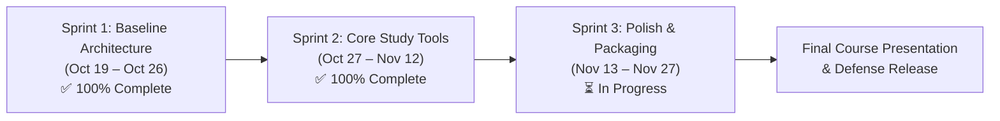

# 🗺️ ScholarSync — Development Roadmap & Timeline

**Repository:** [AppDev-Group-1-CS-A/ScholarSync-Appdev](https://github.com/AppDev-Group-1-CS-A/ScholarSync-Appdev)  
**Project Board:** [GitHub Projects #3 (Kanban)](https://github.com/orgs/AppDev-Group-1-CS-A/projects/3)  
**Methodology:** Agile / Scrum (2-Week Sprints)  

---

## 🧭 Visual Sprint Progression



---

## 📅 Sprint Schedule & Release Goals

| Phase | Window | Focus / Deliverable Target | Status |
|:---|:---:|:---|:---:|
| **Sprint 1** | Oct 19 – Oct 26 | Multi-tier decoupled architecture, Express REST API, MongoDB connection, RAG Q&A, and basic voice assistant. | **Completed** |
| **Sprint 2** | Oct 27 – Nov 12 | Study workspace: Themes (Sepia/Dark), persistent chat, AI quiz generator, chapter summaries, Swagger docs, and admin portal. | **Completed** |
| **Sprint 3** | Nov 13 – Nov 27 | Cross-platform builds (Capacitor Android APK, Electron Desktop), notes export, voice analytics, and automated E2E tests. | **Active** |

---

## 🔮 Sprint 3 Work Packages (Forward Roadmap)

| Task Code | Work Package | Assignee | Priority | Target SLA | Acceptance Criteria |
|:---:|:---|:---|:---:|:---:|:---|
| **[EXP-01]** | **Study Notes & Summary Export** | Aron / Jerlyn | `Medium` | 3 Days | Export AI chapter summaries & quizzes as `.md` and `.pdf` files. |
| **[VOICE-02]** | **Voice Telemetry & Session Transcripts** | Vencie / Vincel | `Medium` | 4 Days | Dashboard view of total call minutes, past logs, and tutor transcripts. |
| **[MOB-02]** | **Capacitor Android Packaging (.apk)** | Vincel / Keith | `High` | 5 Days | Build signed APK, test offline document cache on physical Android device. |
| **[DESK-01]** | **Electron Native Desktop Shell** | Keith Brian | `Low` | 4 Days | Package Windows desktop `.exe` installer with native window menu. |
| **[QA-03]** | **Automated E2E Regression Suite** | Cristyl / Vencie | `High` | 4 Days | Jest & Supertest automated smoke test suite for all 10 REST endpoints. |
| **[DOCS-03]** | **Final Presentation Deck & Demo Script** | Full Team | `High` | 3 Days | 10-minute rehearsed team slide deck and live feature demonstration script. |

---

## 📊 Kanban Board Workflow & Task Priority Matrix

Managed live at **[GitHub Projects #3](https://github.com/orgs/AppDev-Group-1-CS-A/projects/3)**:

```text
[ 📋 Backlog ] ──► [ 📌 Ready (To Do) ] ──► [ ⏳ In Progress ] ──► [ 🔍 In Review / QA ] ──► [ ✅ Done ]
```

### Priority Definitions
* **`priority: high` (P0/P1):** Critical path deliverables satisfying core course rubric criteria (e.g. REST API, RAG, Quiz, Swagger). 24h SLA.
* **`priority: medium` (P2):** Essential functional and usability enhancements (e.g. Reader themes, mobile drawer, notes export). 48h SLA.
* **`priority: low` (P3):** Aesthetic tweaks, desktop shell packaging, and future exploratory features.

